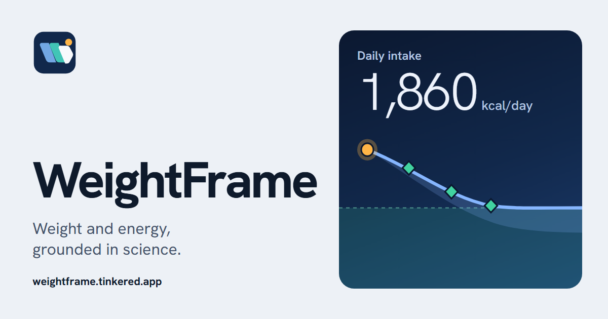

  

<h1 align="center">WeightFrame</h1>

  <b>Weight and energy numbers, each linked to its source.</b> 
  BMI, resting metabolic rate, daily energy needs and a weight-change projection, for adults and children.

  <a href="https://weightframe.tinkered.app/"><b>▶ Open it</b></a>
  &nbsp;·&nbsp; English and Polish
  &nbsp;·&nbsp; installs as an app
  &nbsp;·&nbsp; works offline
  &nbsp;·&nbsp; no account

---

An evidence-based, single-page dashboard for weight and energy: BMI (adults and children),
resting metabolic rate, total daily energy expenditure, a dynamic weight-loss projection,
body composition, central-fat risk, safe pace, daily targets. Every number links to the paper or
guideline it comes from.

Live at <https://weightframe.tinkered.app>. English by default, Polish behind the EN/PL switch.
It installs as an app and works offline.

The research behind every formula, which one wins in which scenario, and how the code was
verified is in **[RESEARCH.md](RESEARCH.md)**. A condensed version is in the app under
*Methods* and *Sources*.

## What it covers

| For | Shows |
|---|---|
| Adults | BMI with ethnicity-adjusted cut-offs; Lancet Commission 2025 adiposity check; 10 BMR equations with the evidence-based pick; National Academies 2023 TDEE with its error range; NIH/Hall 2011 dynamic projection vs the 3,500 kcal rule; intake to reach a goal by a pace or date; composition of the loss; milestones; maintenance after the goal; safety flags; body-fat estimates; waist, waist-to-height, waist-to-hip; protein, macros, fibre, water, activity |
| Children 2–17 | CDC and WHO BMI-for-age percentiles/z-scores (CDC 2022 extended method above the 95th percentile), growth chart, energy for growth, guideline-based goals (no calorie-deficit plans) |

## Data

There are no accounts, no server-side storage, no analytics and no third-party requests. Inputs,
language, units, theme and the closed disclaimer are kept in the browser's `localStorage` and never
leave the device. Clearing the site's data in the browser removes them.

**Share** copies a link with the inputs after a `#`. Browsers do not send that part to the server,
but anyone who gets the link sees the values. The app reads the link once and then clears it from
the address bar.

## Restoring

The site is a Cloudflare Worker with static assets only. Restoring it means redeploying a
known-good commit; there is no server-side data to restore. A user moves their inputs to another
device or browser with a **Share** link.

## Development

Commands, architecture and conventions are in [AGENTS.md](AGENTS.md).

## Credits

- Author: Kuba (kuba@tinkered.app)
- Fonts: Hanken Grotesk and JetBrains Mono, SIL Open Font License 1.1, licence texts in
  [public/assets/fonts/](public/assets/fonts)
- Growth references: CDC 2000 and WHO 2006/2007 BMI-for-age tables, original downloads in
  [data-src/](data-src)

## Disclaimer

Population-based estimates, not medical advice. Individual energy needs vary by roughly ±10–15%
around any equation. Pregnancy, breastfeeding, eating disorders, diabetes medication, chronic
illness and children's weight management need individual clinical care.
